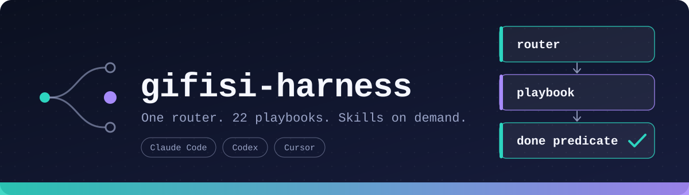
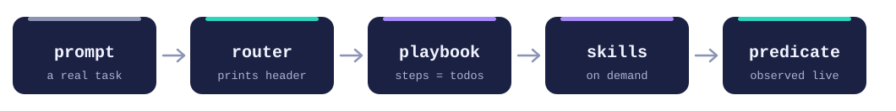

<p align="center">
  <picture>
    <source media="(prefers-color-scheme: dark)" srcset="docs/assets/banner-dark.svg">
    <source media="(prefers-color-scheme: light)" srcset="docs/assets/banner-light.svg">
    
  </picture>
</p>

**English** · [Português (Brasil)](README.pt-BR.md)

[](https://github.com/GiFiSi/gifisi-harness/actions/workflows/ci.yml)
[](LICENSE)
[](docs/setup.md)

One always-on router, 22 playbooks and on-demand skills: an engineering harness for coding agents in Claude Code, Codex and Cursor.

The router is under 150 lines and is the only thing loaded at session start. It classifies each request, picks one playbook, and the agent opens playbooks, skills and principles only when a step needs them. You never type a slash command.

It combines two MIT projects: the playbooks, principles and skills of [Lauren Tan's pstack](https://github.com/cursor/plugins/tree/main/pstack), and the setup, bootstrap, adoption, docs layout and quality gates of [Matheus Gomes's Vibe Coding Toolkit](https://github.com/soumatheusgomes/vibe-coding-toolkit).

## How it works

<p align="center"></p>

For any non-trivial task the agent prints this header before it reads or edits code:

```text
[GIFISI-HARNESS] Task Type: <category> | Playbook: <selected playbook>
Reason: <1 sentence why this playbook fits>
Done Predicate: <exact verifiable condition on the real artifact>
```

Then it copies the playbook's numbered steps into its todo list and runs them in order. It is done only after it observes the predicate on the running app, the CLI output or the generated file; otherwise it reports `INCONCLUSIVE`. Each decision and verification becomes a row in `.gifisi/decisions.tsv`, and repeated mistakes climb a correction ladder: architecture first, then a lint or test, then text. When two routes fit, `node scripts/classify-task.mjs "<prompt>"` ranks them in English and Portuguese. The design is in [docs/design.md](docs/design.md).

## Quickstart

Requirements: Node 18 or newer and bash (Git Bash on Windows). There are no npm dependencies.

```bash
./install.sh --project /path/to/your-project   # one project
./install.sh --global                          # every session of your user account
```

Add `--dry-run` to print the actions without writing. Running the same command twice is safe: the second run reports `writes=0`. Your own text in `AGENTS.md`, `CLAUDE.md`, `~/.claude/CLAUDE.md` and `~/.codex/AGENTS.md` is kept byte for byte; the router lives in a managed block. The installer never touches `package.json`, lockfiles, tests, lint configs or source files. Details and uninstall steps are in [docs/setup.md](docs/setup.md).

## What is inside

| | | Where |
|---|---|---|
| Playbooks | 22 | [core/playbooks/](core/playbooks/) |
| Principles | 24 | [core/principles/](core/principles/) |
| Skills | 31 | [core/skills/](core/skills/) |
| Prompts | 9 | [core/prompts/](core/prompts/README.md) |
| Templates | 31 | [core/templates/](core/templates/) |

The full list with one line per item is in [docs/catalog.md](docs/catalog.md).

## Verify it

Run these from a checkout of this repository:

```bash
node scripts/validate-harness.mjs          # canonical sets, file shapes, links, router drift, unit tests
node scripts/check-install.mjs             # install twice per fixture: clean first run, writes=0 on the second
node scripts/run-autonomous-smoke-test.mjs # broken app: reproduce, fix, add a feature, refactor, verify live
```

[docs/quality.md](docs/quality.md) explains what each one checks and what it does not.

## Limits

- The smoke test is not an agent. Its code edits are scripted stand-ins; the classification, tests, live HTTP checks, quality gate and decision rows around them are real runs.
- The global install writes `.cursor/rules/gifisi-harness.mdc`. Cursor may only load user-level rules that you add in its Settings, and the installer does not verify that it does.
- The router is text. A harness that ignores `AGENTS.md`, `CLAUDE.md` or Cursor rules will not see it. The header makes it visible when routing did not happen.
- Context7, Graphify and RTK are optional and checked before use.
- Installing tools, publishing, pushing and destructive actions still need your explicit OK.

## Docs

[Architecture](docs/architecture.md) · [Design](docs/design.md) · [Setup](docs/setup.md) · [Quality](docs/quality.md) · [Onboarding](docs/onboarding.md) · [Catalog](docs/catalog.md) · [Product](docs/PRODUCT.md) · [Contributing](docs/CONTRIBUTING.md) · [Security](SECURITY.md)

## Credits and license

MIT ([LICENSE](LICENSE)). It adapts pstack by Lauren Tan and the Vibe Coding Toolkit by Matheus Gomes, both MIT. The license texts and the list of adapted material are in [docs/THIRD_PARTY_NOTICES.md](docs/THIRD_PARTY_NOTICES.md).
